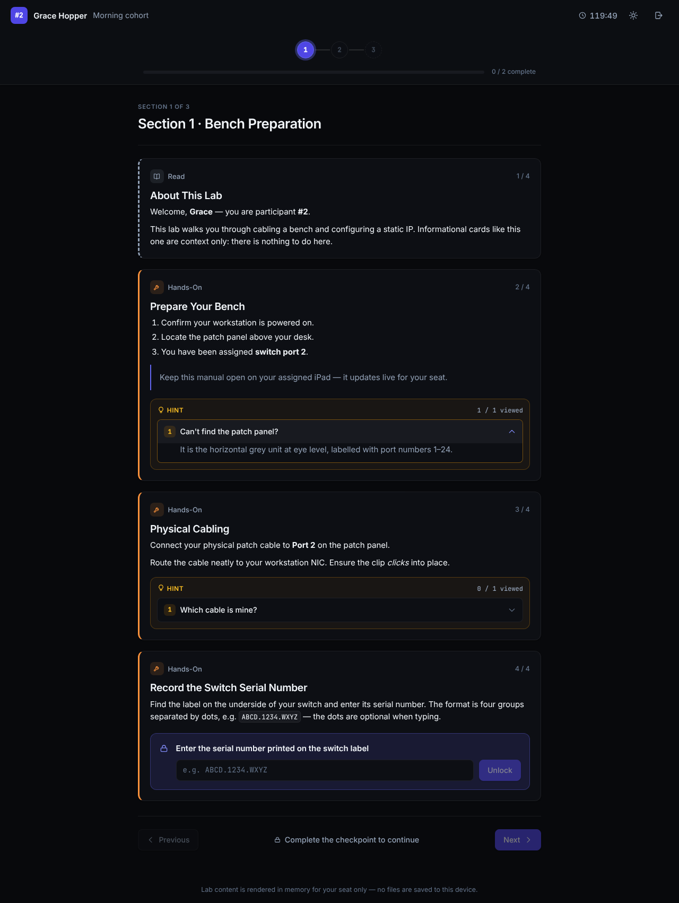
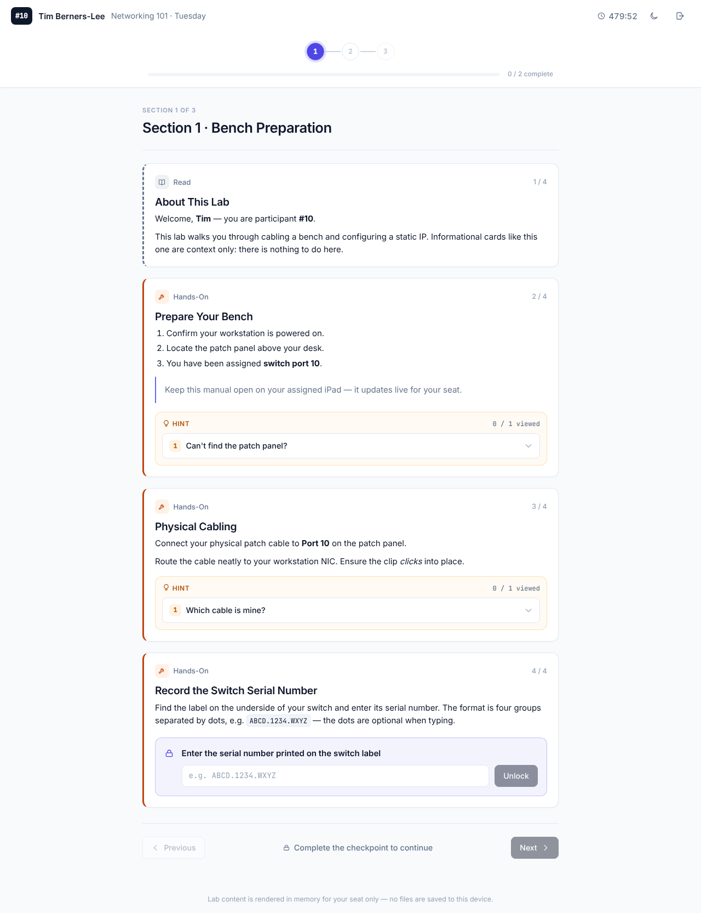
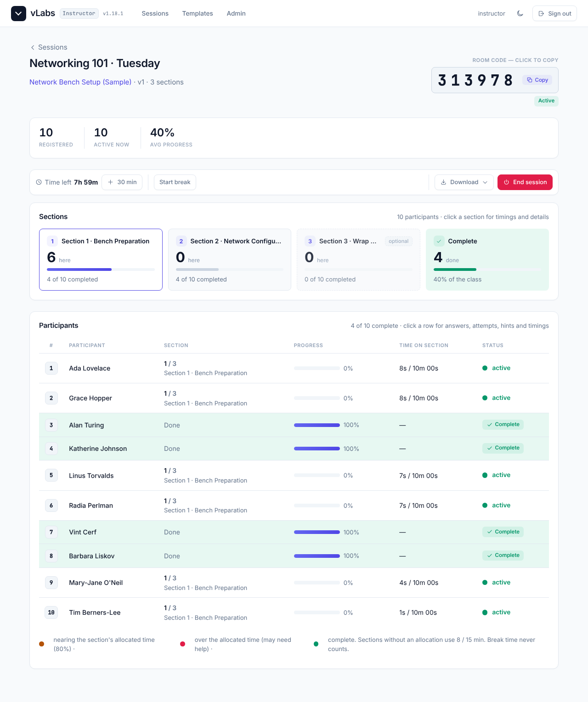
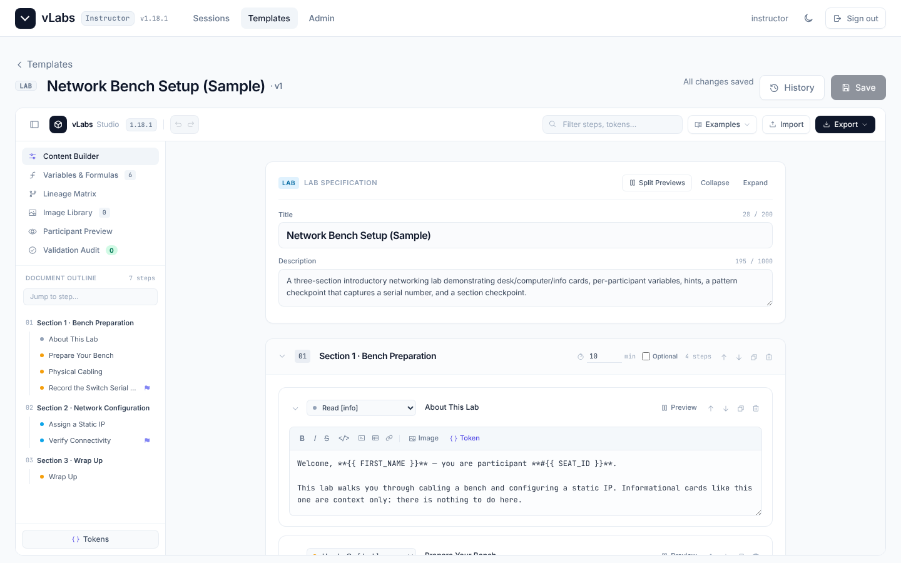
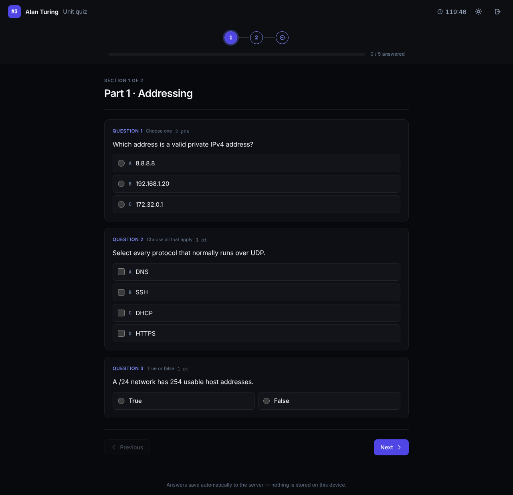
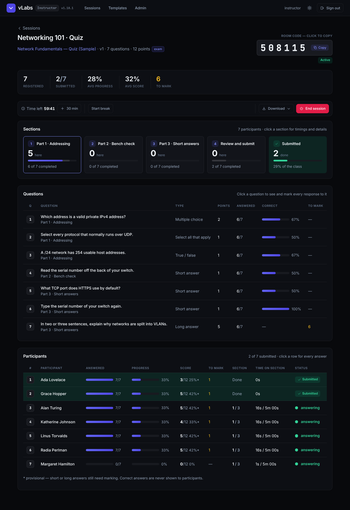
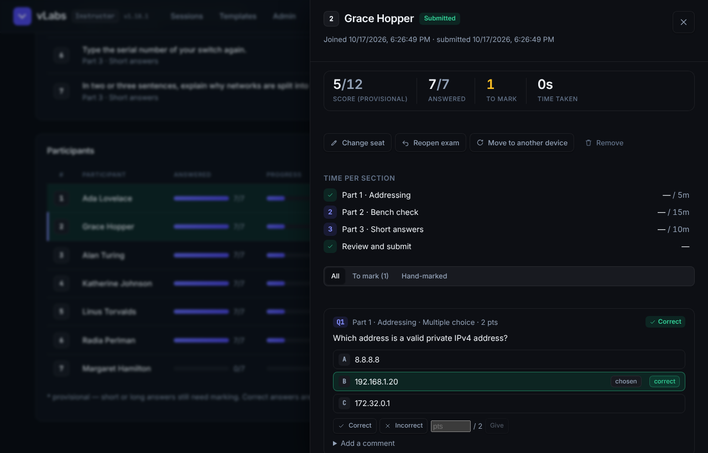

# vLabs — Dynamic Lab Manual Web Application

A secure, session-gated web application that replaces static, per-device PDF lab
manuals with a **dynamic templating engine** that personalises instructions for
every participant in real time.

Built to the _Dynamic Lab Manual Web Application_ technical specification:
eliminate physical PDF provisioning, enforce strict IP protection (no
downloadable materials), and deliver per-seat instructions live to classroom
devices.

Labs are organised into **sections** (each a page of steps) that participants
move through one at a time. Labs and exams are written in **vLabs Template
Studio**, which is the portal's template editor and also ships as one file
that works offline (`docs/vlabs_template_studio.html`).
**Exams** are a second template kind: sections of steps (informational
text and checklists) and questions (multiple choice, select-all, true/false,
short and long answers) in any mix, short answers checked by exact answers
or a pattern like lab checkpoints, graded automatically or by hand, with
answers never shown to participants ([docs/EXAM_GUIDE.md](docs/EXAM_GUIDE.md)).
The UI matches the Template Studio — slate neutrals with an indigo accent,
Inter and JetBrains Mono, a clean geometric line-icon set — with **full light
& dark modes**.

## Screenshots

| Participant lab — one section per page (dark)                  | Section with a checkpoint (light)                                     |
| -------------------------------------------------------------- | --------------------------------------------------------------------- |
|  |  |

| Instructor session monitor                               | Template editor (vLabs Template Studio)                  |
| -------------------------------------------------------- | -------------------------------------------------------- |
|  |  |

| Exam — participant (dark)                                  | Exam monitor — grading (dark)                      | Exam — marking one participant                     |
| ---------------------------------------------------------- | -------------------------------------------------- | -------------------------------------------------- |
|  |  |  |

Participant registration (the default landing page) is in
[`docs/screenshots/register.png`](docs/screenshots/register.png).

---

## Table of contents

- [Highlights](#highlights)
- [Authoring templates → docs/TEMPLATE_GUIDE.md](docs/TEMPLATE_GUIDE.md)
- [Exams → docs/EXAM_GUIDE.md](docs/EXAM_GUIDE.md)
- [Production readiness audit → docs/PRODUCTION_READINESS.md](docs/PRODUCTION_READINESS.md)
- [Architecture](#architecture)
- [Tech stack](#tech-stack)
- [Quick start (local dev on a Mac)](#quick-start-local-dev-on-a-mac)
- [Hosting a class (Raspberry Pi, bare metal + systemd)](#hosting-a-class-raspberry-pi-bare-metal--systemd)
- [How it works](#how-it-works)
  - [The templating engine](#the-templating-engine)
  - [Progressive disclosure & checkpoints](#progressive-disclosure--checkpoints)
  - [Sessions are snapshots](#sessions-are-snapshots)
  - [Registration, seat numbers & resume](#registration-seat-numbers--resume)
  - [Template lifecycle: versions, archive, delete](#template-lifecycle-versions-archive-delete)
  - [Template import / export](#template-import--export)
  - [Theming](#theming)
  - [Security & IP protection](#security--ip-protection)
- [Data model](#data-model)
- [API reference](#api-reference)
- [Configuration](#configuration)
- [Testing & CI](#testing--ci)
- [Deployment notes](#deployment-notes)
- [Upgrading an existing deployment](#upgrading-an-existing-deployment)
- [Project layout](#project-layout)

---

## Highlights

| Spec requirement                                                                                                                                                                                                                                                                                                          | Where it lives                                                                                       |
| ------------------------------------------------------------------------------------------------------------------------------------------------------------------------------------------------------------------------------------------------------------------------------------------------------------------------- | ---------------------------------------------------------------------------------------------------- |
| **Instructor Portal** — create sessions, generate 6-digit codes, monitor, extend, push template updates & terminate                                                                                                                                                                                                       | `client/src/pages/Dashboard.jsx`, `SessionMonitor.jsx`; `server/src/routes/sessions.js`              |
| **Participant registration** — first + last name, auto-assigned number (1–100) in join order                                                                                                                                                                                                                              | `client/src/pages/Join.jsx`; `server/src/routes/participant.js`                                      |
| **Participant-first login** — registration is the default page; a small link goes to the instructor sign-in                                                                                                                                                                                                               | `client/src/App.jsx`                                                                                 |
| **Dynamic templating** — one master template, `{{ PLACEHOLDERS }}` resolved per seat from sandboxed formulas                                                                                                                                                                                                              | `shared/templating.js`                                                                               |
| **Sectioned manuals** — desk vs computer cards, hints, step solutions, checkpoints gating the next section                                                                                                                                                                                                                | `shared/templating.js`, `client/src/pages/Lab.jsx`, `components/StepCard.jsx`                        |
| **Frozen-at-launch sessions** — a running class never changes under participants; instructor pushes updates explicitly                                                                                                                                                                                                    | `server/src/lib/sessionLifecycle.js`, `routes/sessions.js`                                           |
| **Template authoring** — vLabs Template Studio is the template editor (labs and exams), with the same Studio as one offline file; `.zip` with images, `.md`, `.json` import/export, live per-seat preview, variable map, immutable change history with revert                                                             | `client/studio/`, `client/src/pages/TemplateEditor.jsx`, `shared/`                                   |
| **Examination mode** — exam templates (sections mixing informational / checklist steps and single / multiple / true-false / short / long questions; short answers by exact match or pattern), autosave + submit lock, answers never sent to participants, automatic + manual grading, grade-by-question, CSV/JSON exports | `shared/exam-schema.js`, `routes/exam.js`, `lib/examGrading.js`, `pages/Exam.jsx`, `ExamMonitor.jsx` |
| **Archive instead of delete** — templates archive by default; permanent deletion keeps session analytics and history                                                                                                                                                                                                      | `server/src/routes/templates.js`                                                                     |
| **IP protection** — content is JSON to the DOM only, `no-store`, no file endpoints, print-hidden                                                                                                                                                                                                                          | `server/src/routes/participant.js`, `client/src/styles.css` (print rules)                            |
| **Session gating & kill-switch** — every participant request re-validates the live session                                                                                                                                                                                                                                | `server/src/middleware/auth.js`                                                                      |
| **Rate limiting & anti-scraping** — identity-keyed limiters, failed-join brute-force cap, progressive delivery                                                                                                                                                                                                            | `server/src/middleware/rateLimit.js`                                                                 |
| **Live analytics** — "where everyone is" section flow, per-seat section/progress/time/status, click-through detail with answers, wrong attempts, hints and time per section; CSV/JSON exports carry all of it                                                                                                             | `server/src/routes/sessions.js`, `client/src/pages/SessionMonitor.jsx`                               |
| **Image library** — upload PNG/JPEG/GIF/WebP once, reference by file name from any template (``), served offline-safe under random ids                                                                                                                                                                    | `server/src/lib/images.js`, `routes/images.js`, Studio → Image Library                               |
| **Instructor accounts** — add instructors in the portal (**Admin**) or with the Pi's `vlabs-cli.sh`; only the admin account (the bootstrap `instructor`) resets or removes them; password change with revocation of older tokens                                                                                          | `server/src/routes/auth.js`, `client/src/pages/Admin.jsx`, `components/admin/`                       |

## Architecture

```
┌────────────────────────┐      HTTPS (reverse proxy)      ┌──────────────────────────────┐
│  Browser (SPA)         │ ──────────────────────────────▶ │  Node 22 · Express            │
│  React 18 + Vite       │   /api/*  JSON, bearer tokens   │  helmet · cors · rate limits  │
│  participant or        │ ◀────────────────────────────── │  templating engine (sandboxed)│
│  instructor audience   │   no-store rendered content     │  better-sqlite3 (WAL)         │
└────────────────────────┘                                 └──────────────┬───────────────┘
                                                                          │
                                                          ┌───────────────▼──────────────┐
                                                          │ SQLite: instructors,         │
                                                          │ templates, template_audit,   │
                                                          │ sessions (own content copy), │
                                                          │ participants                 │
                                                          └──────────────────────────────┘
```

- In production the Express app serves the built SPA from `client/dist` and the
  API from `/api`, so everything is same-origin behind one TLS proxy.
- In development Vite serves the SPA on `:5173` and proxies `/api` to `:4000`.
- `shared/template-schema.js` is a dependency-free ESM module imported by both
  the server (validation) and the client (editor, import/export) so the template
  shape cannot drift between them.

## Tech stack

| Layer    | Choice                                                            | Why                                                                                    |
| -------- | ----------------------------------------------------------------- | -------------------------------------------------------------------------------------- |
| Backend  | Node 22, Express 4                                                | Small, well understood, runs anywhere Node does (a Pi included)                        |
| Database | SQLite via `better-sqlite3` (WAL)                                 | Single-box deployment; zero ops; synchronous API keeps handlers simple                 |
| Auth     | `jsonwebtoken` (HS256, separate secrets per audience), `bcryptjs` | Stateless tokens + live-session re-validation = instant revocation without a blocklist |
| Security | `helmet` (strict CSP), `express-rate-limit`, `cors`               | Spec's IP protection and anti-scraping requirements                                    |
| Frontend | React 18, React Router 6, Vite 6                                  | Fast SPA with code-split instructor portal                                             |
| Markdown | `marked` + `DOMPurify`                                            | Rich step bodies with defence-in-depth sanitisation                                    |
| Tests    | `node:test` (server + client libs)                                | No extra test dependencies                                                             |
| Tooling  | ESLint 9 (flat config), Prettier 3, GitHub Actions, Dependabot    |                                                                                        |

## Quick start (local dev on a Mac)

Requires **Node 22+** (`brew install node@22` or nvm). Everything runs on
loopback; nothing is reachable from your Wi-Fi.

```bash
npm run setup          # npm ci for the root tooling, server/ and client/
npm run dev            # API (node --watch, :4000) + Vite (:5173) in one terminal
```

Open **http://localhost:5173**. The API restarts on server changes, the SPA
hot-reloads on client changes, and Ctrl-C stops both. No `.env` is needed in
dev — the defaults boot as-is — but `cp .env.example .env` lets you override
anything (the file is always read from the repo root, whatever directory you
start from).

Default instructor credentials (created on first run only, override via env):

```
username: instructor
password: labmanual123
```

The portal shows a banner until this password is changed (**Admin → Your
password**). In production the server refuses to _create_ the bootstrap account
with the default password at all.

**Default no longer works?** The account is only created on an empty
database, and a changed password is kept across restarts. If your local
`server/data/vlabs.sqlite` already has an `instructor` whose password was
changed, the server says so at start-up. Reset it with:

```bash
node server/scripts/instructors.js reset-password instructor labmanual123
```

(or delete `server/data/` to start from a fresh database).

Other root commands: `npm test`, `npm run lint`, `npm run format`,
`npm run build` (writes `client/dist/`), and `npm start` (serves the built SPA
from the API like the Pi does — useful to check a production build locally:
`NODE_ENV=production` plus the three secrets from `.env.example`).

Try it end-to-end:

1. Sign in to the instructor portal (small link on the registration page) →
   **Launch a session** from the seeded _Network Bench Setup_ template. A
   6-digit room code appears (click it to copy).
2. On the default registration page, enter the code and register with a first
   and last name. The server assigns the next number in join order (the first
   participant is `#1`).
3. The lab opens **section by section**, personalised for that number
   (participant `#1` → gateway `192.168.1.101`, host `10.0.0.101`, port `1`,
   cable tag `S01`…). Expand hints, and in section 2 clear the checkpoint
   (`10.0.0.101` or `10.0.0.101/24` — alternative answers are supported) to
   unlock the next section. Close the tab and reopen — a **Resume** banner
   brings you straight back to the same seat and section, or use **Exit** to
   leave.
4. Back in the instructor **session monitor**, see where the class is section
   by section, each participant's progress, time on section and status, and
   click any row for their answers, wrong attempts, hints and time per
   section; **End session** to revoke access instantly.
5. Edit the template while the session is running: nothing changes for
   participants until you click **Push latest version** on the monitor.
6. In **Templates**, open a template in the Studio, import a `.zip`, `.md`
   or `.json`, duplicate or archive a template, and toggle **light / dark
   mode** from the ☾/☀ control on any screen.

## Hosting a class (Raspberry Pi, bare metal + systemd)

The production target is a Raspberry Pi 4/5 (64-bit OS) on the classroom
network: Node runs as a hardened systemd service on `127.0.0.1:4000`, and
**Caddy** terminates HTTPS on `:443` with its built-in CA. One script does the
whole install:

```bash
sudo apt install -y git
sudo git clone https://github.com/not-mehul/vLabs.git /opt/vlabs
sudo /opt/vlabs/deploy/pi/install.sh        # asks for a hostname, generates secrets
```

Participants then open **https://vlabs.local** (after installing the root
certificate once from `http://vlabs.local/vlabs-root.crt`). Updating is
`sudo /opt/vlabs/deploy/pi/update.sh`. The full runbook — network choices,
certificate installation per device type, backups, troubleshooting — is in
[DEPLOYMENT.md](DEPLOYMENT.md).

## How it works

### The templating engine

Instead of maintaining 20 separate manuals, one **master template** is stored as
structured JSON sections/steps containing mustache-style placeholders. Variables
are resolved **per seat** at render time.

Instructors author variable **formulas** (not code). For example:

| Variable     | Expression                    | Seat 7 →        |
| ------------ | ----------------------------- | --------------- |
| `PORT_NUM`   | `seat`                        | `7`             |
| `SEAT_TAG`   | `'S' + pad(seat, 2)`          | `S07`           |
| `GATEWAY_IP` | `'192.168.1.' + (100 + seat)` | `192.168.1.107` |
| `HOST_IP`    | `'10.0.0.' + (100 + seat)`    | `10.0.0.107`    |
| `MAC_SUFFIX` | `pad(hex(seat), 2)`           | `07`            |

Formulas are evaluated by a **hand-written recursive-descent evaluator** — never
`eval()`/`Function()`. It understands numbers, quoted strings, `+ - * / %`,
parentheses, the built-ins `seat`, `first_name` and `last_name`, previously
defined variables (so formulas can compose), and a small whitelist of pure
helpers: `pad`, `hex`, `floor`, `ceil`, `round`, `abs`, `mod`, `min`, `max`,
`upper`, `lower`, `str`, `slug`, `initials`. Anything else — unknown
identifiers, prototype names, `constructor(...)`, semicolons — is rejected.
Expressions are capped in length and nesting depth, text values at 1000
characters, and division by zero is an error. Saving a template evaluates
every formula for every seat 1–100, so a formula that fails for one seat is
refused with that seat's number.

Participant names are first-class: `{{ FIRST_NAME }}`, `{{ LAST_NAME }}` and
`{{ FULL_NAME }}` are always available, and formulas can derive from them —
`USERNAME = slug(first_name) + '.' + slug(last_name)` gives `mary.oneil`,
`initials(first_name + ' ' + last_name)` gives `MO`.

Placeholders are written `{{ NAME }}` in section titles, step titles, bodies,
hints, solutions and checkpoint prompts/answers. `{{ SEAT_ID }}` is always
available. **Saving a template that references an undeclared placeholder is
refused** with the exact location (`Unknown placeholder {{ HOST_IPP }} in
Section 2 · step 2 checkpoint answer`), and the Studio flags it live while you
type — a typo in a checkpoint answer used to silently produce an unpassable
checkpoint.

### Step types

| Type       | Card                   | Can carry                   | Use for                                           |
| ---------- | ---------------------- | --------------------------- | ------------------------------------------------- |
| `desk`     | Hands-On (orange)      | hints, solution, checkpoint | physical bench work                               |
| `computer` | Workstation (blue)     | hints, solution, checkpoint | work on the machine                               |
| `info`     | Read (neutral, dashed) | body only                   | context, background, safety notes — nothing to do |

Info steps never block progress and are stripped of any hint/solution/
checkpoint on save, so switching a step's type in the Studio is always safe.

### Progressive disclosure & checkpoints

Content is delivered **progressively**. A participant only ever receives the
sections they have unlocked, and within the furthest section only the steps up
to the first uncompleted checkpoint:

- **Sections** gate on checkpoints: section _n_ is reachable only once every
  checkpoint in sections _0 … n−1_ is cleared.
- **Steps** within a section reveal up to and including the first open
  checkpoint; clearing it reveals the rest.
- **Checkpoint answers never leave the server.** The participant submits a value
  and the server compares it (whitespace/case-insensitively) against the
  seat-specific primary answer and any authored **alternative answers**.
- **Pattern checkpoints** cover values the author _cannot_ know in advance — a
  device serial, a MAC address, a ticket number. Instead of an answer the
  checkpoint carries a **mask**: `9` digit, `A`/`a` letter (stored upper/lower
  case), `X`/`x` letter or digit, `?` any character, `*` anything, `\c` a
  required literal; other letters and digits must match literally, and
  unescaped punctuation or spaces are **optional separators**. So `XXXX.XXXX.XXXX` accepts `abcd1234wxyz` and
  `ABCD.1234.WXYZ` alike (not `abcd-1234-wxyz`), and canonicalises both to
  `ABCD.1234.WXYZ`. The mask, like an answer, never ships to the browser; the
  participant only sees the prompt and an example placeholder.
- **Captured values.** Any checkpoint may **save the accepted value as a
  variable** (`capture: SERIAL`). From the _next_ step onward the canonical
  value is available as `{{ SERIAL }}` in bodies, hints, solutions, prompts and
  even exact answers of later checkpoints, so a lab can say _"label the switch
  ABCD.1234.WXYZ"_ or verify the participant re-enters the same serial later.
  Referencing a capture before its checkpoint is a save-time error. Captured
  values appear per seat on the session monitor and as columns in the CSV/JSON
  export.
- **Hints** are collapsible; opening one is recorded (analytics). A step's
  optional **solution** (Markdown) can be revealed only after _every_ hint on
  that step has been opened — and it is only sent to the browser at that moment.
- Hints, solutions, checkpoints and progress reports all go through the **same
  reachability gate**: a seat cannot act on a step it cannot yet see.

### Sessions are snapshots

Launching a session **copies the template** (title, content, variables and
version number) into the session row. Participants are rendered from that copy,
so:

- Editing the master template mid-class never shifts step or checkpoint indices
  under participants.
- The session monitor shows _"Template v3 is available — this session is
  running v2"_ with a **Push latest version** button. Pushing copies the new
  version into the session; participants' status poll notices the version
  change and reloads the manual within ~15 s. Progress, answers, marks and
  section times move with their sections and items, matched by the stable
  ids every saved template carries (`server/src/lib/contentRemap.js`); work on
  removed items is dropped, and section pointers are clamped to the new
  length.
- Exports and analytics of ended sessions keep working even if the template is
  later archived or permanently deleted.

Sessions that pass `expires_at` without being terminated are swept to _ended_
after a grace window (`EXPIRED_SESSION_GRACE_MINUTES`, default 60) so their room
codes recycle; the grace keeps "+30 min" working on a session that just ran
out.

### Registration, seat numbers & resume

1. **Named registration** — participants enter a room code plus first and last
   name. The server assigns the next ascending seat number in join order (max
   100 per session); that number is what formulas see as `seat`. An exam or a
   lab launched with **Seats from** a lab session (an exam after a lab, or
   day two of a lab) gives anyone found in that lab (by name) their lab
   seat, and so the same values; **Change seat** on the monitor fixes typos
   and name clashes (EXAM_GUIDE.md §4.2, TEMPLATE_GUIDE.md §1).
2. **Idempotent rejoin** — registering again with the same name (case- and
   whitespace-insensitive) in the same session returns the _same_ number and
   progress, even from a different device or after clearing storage.
3. **Resume** — the participant token (never any content) is stored in
   `localStorage`; the registration page validates it with the lightweight
   `/status` probe and offers a _Resume_ banner while the session is live.

### Template lifecycle: versions, archive, delete

- Every save bumps `version` and appends an immutable **audit** entry with a
  full snapshot (append-only is enforced by database triggers). The editor's
  **History** summarises each version and can **revert** (loads the old
  snapshot for review; saving creates a new version).
- **Archive** (the default "delete") hides a template from the list and the
  session launcher. Archived templates remain readable/editable and can be
  **restored**. Launching a session from an archived template is refused.
- **Permanent deletion** is available on archived templates, behind a warning
  and a typed confirmation, and refused while a session launched from it is
  still active. Sessions keep their own copy (`template_id` becomes `NULL`);
  the audit history, including a final snapshot, survives.
- Templates are a **shared workspace** — any instructor can edit any template.
  Sessions belong to the instructor who launched them.

### Template import / export

Labs and exams are written in **vLabs Template Studio**. Opening a template
under **Templates** (or **New lab**, **New exam**) edits it in the Studio
inside the portal: **Save** stores a new version, the image library is the
portal's, and **History** lists every version with revert. The same Studio
ships as one file that works offline (**Templates → Offline Studio**, or
`docs/vlabs_template_studio.html`): write there, export its **`.zip`
package** (`template.json` + `images/`), and **Templates → Import** uploads
the images and opens the template in one step; `.md` and `.json` work too.
Both are built from one codebase, `client/studio/` (see its README), on the
same rules vLabs saves with (`shared/`), so a template that passes the
Studio's Validation Audit is one vLabs accepts.
Exams have their own format ([docs/EXAM_GUIDE.md](docs/EXAM_GUIDE.md)).
**[docs/TEMPLATE_GUIDE.md](docs/TEMPLATE_GUIDE.md) is the complete authoring
reference** — model, Markdown syntax, every validation rule, the formula and
mask languages, delivery/gating behaviour, and four ready-to-import example
templates for different kinds of courses.

- **Export** as **JSON** (canonical form) or **Markdown** (human-friendly).
- **Import** a Studio `.zip`, `.json` or `.md` file to create a lab or replace
  its content (review, then Save).
- The Markdown convention (documented in `shared/template-format.js`)
  uses frontmatter for `title`/`description`/`variables`, `#` for sections,
  `## [desk|computer|info]` for steps, and `> hint:` / `> solution:` /
  `> checkpoint:` / `> accept:` / `> pattern:` / `> capture:` /
  `> placeholder:` directives, the last four the same lines exams use.
  Fenced code blocks are copied verbatim (a `#` inside one is not a heading),
  hints may span multiple quoted lines, `\::` and `\|` escape the separators,
  and `> accept: a | b` lists a checkpoint's accepted answers. A
  `> checkpoint: prompt` line followed by `> pattern: XXXX.XXXX.XXXX`
  instead is a pattern checkpoint; `> capture: SERIAL`
  saves the accepted value for later steps. **Round-trips are lossless**
  (covered by `client/tests/templateFormat.test.js`).

### Theming

A `ThemeContext` provides **light and dark modes** built on CSS custom
properties toggled on `<html data-theme>`. The initial theme follows the OS
`prefers-color-scheme`; the user's manual choice is persisted to `localStorage`
and a toggle is available on every screen. Colours and type match **vLabs
Template Studio**: slate neutrals on `#f8fafc` with an indigo accent (`#4f46e5`;
primary actions are slate-900 in light mode and indigo in dark), the Studio's
near-black surface scale in dark mode (`#08090c` → `#181a20`), and the
self-hosted **Inter** and **JetBrains Mono** typefaces (CSP-safe, no external
requests), plus an original set of geometric line icons
(`components/Icon.jsx`). All colours are CSS custom properties at the top of
`client/src/styles.css`.

### Security & IP protection

| Requirement                       | Implementation                                                                                                                                                                                                                                                                                                                                                                                                                                                                             |
| --------------------------------- | ------------------------------------------------------------------------------------------------------------------------------------------------------------------------------------------------------------------------------------------------------------------------------------------------------------------------------------------------------------------------------------------------------------------------------------------------------------------------------------------ |
| **IP protection**                 | Lab content is delivered as JSON to the DOM only. No PDF/DOCX/file endpoints exist; rendered content is served with `Cache-Control: no-store`; the lab view is hidden when printing (a deterrent, not a control). Only an access token is persisted for resume — never content.                                                                                                                                                                                                            |
| **Session gating**                | Access requires a time-limited 6-digit code. Every participant request re-validates the live session (`is_active` + `expires_at`) and the seat, so a token is rejected the instant an instructor terminates the session or it expires — no token blocklist needed.                                                                                                                                                                                                                         |
| **Progressive delivery**          | A seat can only pull sections/steps it has legitimately reached, which caps what any single seat (or scraper) can extract.                                                                                                                                                                                                                                                                                                                                                                 |
| **Anti-scraping / rate limiting** | Layered `express-rate-limit`. Authenticated limits are keyed on the **verified identity inside the token** (participant/instructor id), not the raw header — so a classroom behind one NAT is not throttled as one client, garbage tokens cannot mint fresh buckets, and re-joining cannot reset a seat's checkpoint-guessing or content limits. Anonymous joins are capped per IP on _failed_ attempts (code enumeration) and, more generously, on total attempts (token-minting floods). |
| **Formula sandbox**               | Instructor formulas run in a purpose-built evaluator with a fixed function whitelist, no property access, and length/depth caps.                                                                                                                                                                                                                                                                                                                                                           |
| **Authored content**              | Templates are validated and size-capped server-side; Markdown is rendered through `marked` and sanitised with DOMPurify (inline `style` and form elements stripped; images only from the app's own library or `data:` URIs; links open in a new tab with `rel=noopener`).                                                                                                                                                                                                                  |
| **Transport & headers**           | Designed to run behind mandatory HTTPS/TLS (reverse proxy). Strict `helmet` CSP with **no `unsafe-inline`**, `frame-ancestors 'self'` (only the portal frames the Studio), `no-referrer`, `noindex`. `TRUST_PROXY` must match the topology.                                                                                                                                                                                                                                                |
| **Credentials**                   | Instructor passwords hashed with bcrypt (constant-time compare with a dummy hash for unknown users); separate HS256 secrets per token audience; instructor tokens carry a `token_version` so **changing the password revokes every older token**.                                                                                                                                                                                                                                          |
| **Fail-fast configuration**       | In production the server refuses to start with weak/placeholder JWT secrets, identical secrets, or when it would create the bootstrap instructor with the default password.                                                                                                                                                                                                                                                                                                                |
| **Operational**                   | Structured request/audit logging (no bodies or tokens), DB-backed health check, graceful shutdown that closes SQLite cleanly.                                                                                                                                                                                                                                                                                                                                                              |

Known trade-off (by design): seat **rejoin is name-only** for classroom
simplicity, so a participant who knows a classmate's name in a live session
could take over their seat. If that matters for your environment, run kiosk
devices and keep room codes private.

## Data model

SQLite tables (`server/src/db/index.js`), migrated with `PRAGMA user_version`
(current version **13**; each migration is listed in [CHANGES.md](CHANGES.md)
with the release that added it):

- **`instructors`** — `id`, `username`, `password_hash`, `token_version`
  (bumped on password change or reset; embedded in JWTs),
  `password_changed_at` (NULL = temporary password), `is_admin` (the
  bootstrap account; stored, so `SEED_INSTRUCTOR_USERNAME` changing later
  does not move it), `created_at`.
- **`templates`** — `id`, `kind` (`lab | exam`, fixed at creation), `title`,
  `description`, `content` (JSON sections), `variables` (JSON formulas),
  `version`, `archived_at`, `created_by`, timestamps.
- **`template_audit`** — append-only history: `template_id`, `template_title`,
  `action` (`created | updated | archived | restored | deleted`), `version`,
  `snapshot` (full JSON), `instructor_id`, `instructor_username`, `at`.
  `UPDATE`/`DELETE` are rejected by triggers.
- **`sessions`** — `id`, `room_code`, `title`, `kind`, `template_id`
  (nullable, `ON DELETE SET NULL`), `instructor_id`, **`template_version`,
  `template_title`, `content`, `variables`** (the session's own snapshot),
  `is_active`, `expires_at`, `created_at`, `ended_at`, `breaks` (JSON class
  breaks), `seat_source_session_id` (**Seats from**). A partial unique index
  keeps room codes unique among _active_ sessions only.
- **`participants`** — `id`, `session_id`, `seat_number` (from 1 in join
  order, at most 100 participants per session; **Change seat** allows up to
  999), `first_name`, `last_name`, `name_key` (NFC, lower-cased "first last"),
  `current_section`, `max_section`,
  `completed_checkpoints` (JSON `"section.step"` keys), `captured_values`
  (JSON `{ NAME: "canonical value" }` from capturing checkpoints),
  `checkpoint_log` (JSON `[{ k, a, ok, at, by? }]`, every attempt as typed,
  capped at 200), `section_times` (JSON seconds per section for closed
  visits), `hints_taken`, `revealed_solutions`, `completed_at` (set by the
  server when every section is cleared; the clock stops), `finished_at`
  (pressed Finish), `section_entered_at`, `joined_at`, `last_seen_at`. Exams
  add `answers`, `grades` (marks, part marks and comments), `submitted_at`,
  `auto_submitted`, `resume_hash` (device binding) and `token_version`
  (bumped when the seat is released). Unique on `(session_id, seat_number)`
  and `(session_id, name_key)`.
- **`exam_answer_events`** — append-only answer history, one row per change
  (`participant_id`, `question_key`, `response`, `at`).
- **`images`** — `id` (random, in URLs), `name` (unique, case-insensitive;
  what templates reference), `mime`, `size`, `width`, `height`, `data`
  (blob), `created_by`, `created_at`.

Lab content shape (`shared/template-schema.js`; exams are in
`shared/exam-schema.js`). Every section, step and exam item carries a stable
`id`, given on save, that lets **Push latest version** move work with it:

```json
{
  "id": "k3x9a2bq",
  "title": "Section title with {{ VARS }}",
  "minutes": 20,
  "optional": false,
  "steps": [
    {
      "id": "p0w7c1zd",
      "type": "desk | computer | info",
      "title": "…",
      "body": "markdown with {{ VARS }}",
      "hints": [{ "label": "…", "text": "markdown" }],
      "solution": "markdown (optional)",
      "checkpoint": {
        "prompt": "…",
        "placeholder": "…",
        "mode": "exact | pattern",
        "answer": "{{ HOST_IP }}",
        "answers": ["{{ HOST_IP }}/24"],
        "pattern": "",
        "capture": ""
      }
    }
  ]
}
```

## API reference

All routes are under `/api`. Errors are `{ error, code?, details? }`.

### Public

| Method | Path                | Description                                                                                                                                                                                                                    |
| ------ | ------------------- | ------------------------------------------------------------------------------------------------------------------------------------------------------------------------------------------------------------------------------ |
| `GET`  | `/health`           | Liveness; runs a DB query, `503` if it fails                                                                                                                                                                                   |
| `POST` | `/auth/login`       | `{ username, password }` → `{ token, instructor }` (`must_change_password` flag)                                                                                                                                               |
| `POST` | `/participant/join` | `{ room_code, first_name, last_name, resume_key? }` → `{ token, resumed, seat_number, session, resume_key }`. Exam seats are bound to the joining device by `resume_key`; rejoining an exam name without it → `409 SEAT_TAKEN` |
| `GET`  | `/images/:id/:name` | Serve a library image (the random id is the capability; cacheable)                                                                                                                                                             |

### Instructor (Bearer instructor token)

Templates are shared by every instructor. Any instructor can **read** any
session (its monitor, participants, sections, questions and export); only the
instructor who launched it can **change** it (`403 NOT_SESSION_OWNER`).

| Method   | Path                                                      | Description                                                                                                                                                                                                                                                                                               |
| -------- | --------------------------------------------------------- | --------------------------------------------------------------------------------------------------------------------------------------------------------------------------------------------------------------------------------------------------------------------------------------------------------- |
| `GET`    | `/auth/me`                                                | Current instructor                                                                                                                                                                                                                                                                                        |
| `PUT`    | `/auth/password`                                          | `{ current_password, new_password }` → fresh token; revokes older tokens                                                                                                                                                                                                                                  |
| `GET`    | `/auth/instructors`                                       | Every instructor account with session counts                                                                                                                                                                                                                                                              |
| `POST`   | `/auth/instructors`                                       | `{ username, password? }` → new account (+ `temporary_password` when generated). Any signed-in instructor                                                                                                                                                                                                 |
| `POST`   | `/auth/instructors/:id/reset-password`                    | **Admin only.** New temporary password; signs that instructor out everywhere (`403 ADMIN_ONLY` for anyone else)                                                                                                                                                                                           |
| `DELETE` | `/auth/instructors/:id`                                   | **Admin only.** Remove an account (not yourself); its sessions move to you                                                                                                                                                                                                                                |
| `GET`    | `/templates`                                              | List (add `?include_archived=1`); includes `session_count`, `active_session_count`, `archived_at`                                                                                                                                                                                                         |
| `POST`   | `/templates`                                              | Create (validated; `400` with `details[]`). `kind: 'exam'` creates an exam (fixed at creation)                                                                                                                                                                                                            |
| `GET`    | `/templates/:id`                                          | Full template                                                                                                                                                                                                                                                                                             |
| `PUT`    | `/templates/:id`                                          | Update → new version; running sessions unaffected. Optional `expected_version` → `409 VERSION_CONFLICT` if someone saved in between                                                                                                                                                                       |
| `DELETE` | `/templates/:id`                                          | **Archive** (`204`)                                                                                                                                                                                                                                                                                       |
| `DELETE` | `/templates/:id?permanent=1`                              | Permanently delete; `409` while sessions are active                                                                                                                                                                                                                                                       |
| `POST`   | `/templates/:id/restore`                                  | Un-archive                                                                                                                                                                                                                                                                                                |
| `POST`   | `/templates/:id/duplicate`                                | `{ title? }` → a new template (v1) with the same kind, content and variables, titled "… (copy)" by default                                                                                                                                                                                                |
| `GET`    | `/templates/:id/audit`                                    | Change history (newest first): each entry's `changes` in words and `has_snapshot`, no snapshots                                                                                                                                                                                                         |
| `GET`    | `/templates/:id/audit/:entryId`                           | One history entry with its full `snapshot` (revert)                                                                                                                                                                                                                                                       |
| `GET`    | `/sessions`                                               | This instructor's sessions (`?scope=all`: everyone's, with `owner` and `can_manage`) with `participant_count`, `template_version`, `update_available`                                                                                                                                                     |
| `POST`   | `/sessions`                                               | `{ template_id, title?, duration_minutes?, seat_source_session_id? }` → session (snapshot taken; `409` if template archived). Default length: 480 min for a lab, 60 for an exam                                                                                                                           |
| `GET`    | `/sessions/:id`                                           | Detail + live analytics (`section_distribution` with `minutes` / `avg_seconds` / `completed_count` / `final`, `on_break`, per-participant `time_status` against the section's allocation, `participants[]` incl. `captured`, `capture_names`, `template_exists`, `template_archived`)                     |
| `POST`   | `/sessions/:id/terminate`                                 | End now; participant tokens rejected immediately. Exams: every exam not yet submitted is handed in as it stands (`auto_submitted` count in the response)                                                                                                                                                  |
| `POST`   | `/sessions/:id/break`                                     | `{ on: true \| false }` — start / end a class break: section timers pause for everyone (`409` unless active)                                                                                                                                                                                              |
| `POST`   | `/sessions/:id/extend`                                    | `{ minutes }` added to the later of now / current expiry                                                                                                                                                                                                                                                  |
| `POST`   | `/sessions/:id/push-template`                             | Copy the template's latest version into the live session                                                                                                                                                                                                                                                  |
| `DELETE` | `/sessions/:id`                                           | Delete session and its participants                                                                                                                                                                                                                                                                       |
| `GET`    | `/sessions/:id/export`                                    | Full JSON export: `sections[]` + `checkpoints[]` index, per-participant `section_times[]`, `checkpoints[]` (accepted answer + every wrong attempt with timestamps), `hints_opened[]`, `solutions_revealed_list[]`, `captured`, plus a flat chronological `attempts[]` log (works after template deletion) |
| `GET`    | `/sessions/:id/participants/:pid`                         | One participant in depth: checkpoints with accepted answer + wrong attempts, hints opened, solutions revealed, time per section                                                                                                                                                                           |
| `GET`    | `/sessions/:id/sections/:index`                           | Monitor section details: time allocated, average / median / fastest / slowest, who is on it, completed it or has not reached it; labs add per-step hints, solutions and checkpoint results (common wrong answers), exams the section's question results                                                   |
| `GET`    | `/server/addresses`                                       | Where participants can reach this vLabs right now (`urls`); on the Pi it follows network changes, elsewhere it is empty                                                                                                                                                                                   |
| `PUT`    | `/sessions/:id/participants/:pid/marks/:key`              | Exams: any of `{ correct: true \| false \| null, points: N \| null, comment: string \| null }` — mark a response by hand, give part of its points (0 … its points, halves allowed), or leave a marker's comment (null clears)                                                                             |
| `GET`    | `/sessions/:id/questions/:key`                            | Exams: every participant's response to one question                                                                                                                                                                                                                                                       |
| `POST`   | `/sessions/:id/participants/:pid/checkpoints/:key/unlock` | Labs: clear a checkpoint the participant has reached but is stuck on (instructor only; logged as cleared by you). `{ value }` is required when a pattern checkpoint saves the answer as a variable (`400 VALUE_REQUIRED`)                                                                                 |
| `DELETE` | `/sessions/:id/participants/:pid`                         | Remove a participant (their device is signed out with `SEAT_REMOVED`)                                                                                                                                                                                                                                     |
| `POST`   | `/sessions/:id/participants/:pid/release`                 | Exams: let the seat be resumed on another device (signs out the current one with `SEAT_RELEASED`)                                                                                                                                                                                                         |
| `POST`   | `/sessions/:id/participants/:pid/reopen`                  | Exams: undo a submission while the session is live                                                                                                                                                                                                                                                        |
| `PUT`    | `/sessions/:id/participants/:pid/seat`                    | `{ seat_number }` — give the participant another seat (and so its values); `409 SEAT_IN_USE` when taken                                                                                                                                                                                                   |
| `GET`    | `/images`                                                 | Image library listing                                                                                                                                                                                                                                                                                     |
| `POST`   | `/images?name=…[&replace=1]`                              | Upload one image as the raw body (type sniffed; PNG/JPEG/GIF/WebP ≤ 3 MB); `409 IMAGE_EXISTS` unless `replace`                                                                                                                                                                                            |
| `GET`    | `/images/:id/references`                                  | Templates (archived ones flagged `archived`) and active sessions using the image, by exact file name                                                                                                                                                                                                       |
| `DELETE` | `/images/:id`                                             | Delete (409 while a template, archived or not, or an active session uses it)                                                                                                                                                                                                                              |

### Participant (Bearer participant token; every call re-validates the session)

| Method | Path                         | Description                                                                                                                                                                                                                                                                                                                                                                                                                                                |
| ------ | ---------------------------- | ---------------------------------------------------------------------------------------------------------------------------------------------------------------------------------------------------------------------------------------------------------------------------------------------------------------------------------------------------------------------------------------------------------------------------------------------------------- |
| `GET`  | `/participant/content`       | Unlocked sections rendered for the seat (checkpoints carry `mode`, never answers/masks); `template_version`                                                                                                                                                                                                                                                                                                                                                |
| `GET`  | `/participant/status`        | Heartbeat: `expires_at`, `finished`, `template_version`, `on_break`, `checkpoints_cleared` (labs: a rise from an instructor unlock reloads the manual)                                                                                                                                                                                                                                                                                                     |
| `POST` | `/participant/checkpoint`    | `{ section_index, step_index, answer }` → `{ correct, section_cleared?, unlocked_section? }`; stores the canonical value when the checkpoint captures one                                                                                                                                                                                                                                                                                                  |
| `POST` | `/participant/progress`      | `{ section_index }` — section being viewed                                                                                                                                                                                                                                                                                                                                                                                                                 |
| `POST` | `/participant/hint`          | `{ section_index, step_index, hint_index }`                                                                                                                                                                                                                                                                                                                                                                                                                |
| `POST` | `/participant/solution`      | `{ section_index, step_index }` → `{ solution }` once all hints are open                                                                                                                                                                                                                                                                                                                                                                                   |
| `POST` | `/participant/finish`        | Mark the lab complete                                                                                                                                                                                                                                                                                                                                                                                                                                      |
| `GET`  | `/participant/exam`          | Exams: the **unlocked** sections (no answers or masks; each section's `items` in order: steps `{ type: 'info' \| 'checklist', title, body, tasks? }` with tick keys, questions with `key`, `number` and an optional `placeholder`; the submit section with `body` + `review`) + the seat's saved responses and ticks, `unlocked_section`, `total_sections`, `submit_section`, `on_break`. After submission: no questions or answers, only `answered_count` |
| `POST` | `/participant/exam/progress` | Exams: `{ section_index }` — section being viewed (time per section); `403` if locked                                                                                                                                                                                                                                                                                                                                                                      |
| `PUT`  | `/participant/exam/answer`   | Exams: `{ key, value }` autosave → `{ unlocked_section, section_complete }`; a checklist item (`"2.t0"`, numbered across the section's checklists) takes `true` / `null` (unticking re-locks later sections) (`403` locked section, `409 SUBMITTED` once handed in)                                                                                                                                                                                        |
| `POST` | `/participant/exam/submit`   | Exams: hand in (idempotent); locks responses                                                                                                                                                                                                                                                                                                                                                                                                               |

Participant error codes: `SESSION_ENDED`, `SESSION_EXPIRED`, `SEAT_REMOVED`,
`SEAT_RELEASED`, `SEAT_TAKEN`, `WRONG_KIND` (lab route on an exam session or
vice versa), `SUBMITTED`. Instructor: `TOKEN_REVOKED`, `VERSION_CONFLICT`.

Rate limits (per minute unless noted): API 300 per identity/IP; library
images 3000 per IP (they are fetched without a token); join 20 failed
per IP / 5 min and 300 total per IP / 5 min; login 10 failed per IP / 15 min;
per seat: checkpoint 30, content/status/solution 120, other actions 120.

## Configuration

Copy `.env.example` → `.env` at the repo root (the server reads that file from
wherever it is started; real environment variables win). On the Pi the same
variables live in `/etc/vlabs/vlabs.env`, generated by `deploy/pi/install.sh`
and loaded by systemd. Everything has a dev default so the app boots with no
config; **production refuses to start** when secrets are weak/placeholder,
identical, or when it would create the bootstrap instructor with the default
password.

| Variable                                                | Default                         | Purpose                                                                                                               |
| ------------------------------------------------------- | ------------------------------- | --------------------------------------------------------------------------------------------------------------------- |
| `NODE_ENV`                                              | `development`                   | `production` enables the guard rails and JSON logs; the Pi unit forces it                                             |
| `HOST`                                                  | `127.0.0.1`                     | Bind address. Loopback in dev (Vite proxies) and on the Pi (Caddy proxies); `0.0.0.0` only to expose Node itself      |
| `PORT`                                                  | `4000`                          | API / server port                                                                                                     |
| `DB_PATH`                                               | `server/data/vlabs.sqlite`      | SQLite file location (`/var/lib/vlabs/vlabs.sqlite` on the Pi)                                                        |
| `JWT_INSTRUCTOR_SECRET`                                 | dev value                       | Instructor token key (≥ 32 chars in production)                                                                       |
| `JWT_PARTICIPANT_SECRET`                                | dev value                       | Participant token key (must differ from the above)                                                                    |
| `JWT_INSTRUCTOR_TTL` / `JWT_PARTICIPANT_TTL`            | `12h`                           | Token lifetimes; a participant token lasts this long past its session's expiry                                        |
| `SEED_INSTRUCTOR_USERNAME` / `SEED_INSTRUCTOR_PASSWORD` | `instructor` / `labmanual123`   | Bootstrap instructor, the admin (first run only)                                                                      |
| `MIN_PASSWORD_LENGTH`                                   | `10`                            | Policy for new passwords (portal and CLI), 1–200                                                                      |
| `TRUST_PROXY`                                           | unset (`false`)                 | Express `trust proxy`: `1` behind Caddy on the Pi, `true`, a hop count, or CIDR list                                  |
| `SERVE_PLAIN_HTTP`                                      | `false`                         | Only for TLS-less `http://` access: drops HSTS + `upgrade-insecure-requests`. Not needed on the Pi (Caddy does HTTPS) |
| `CORS_ORIGINS`                                          | `http://localhost:5173`         | Allowed origins (empty in prod, same-origin)                                                                          |
| `LOG_LEVEL`                                             | `info` (`silent` in tests)      | `debug                                                                                                                | info | warn | error | silent` |
| `LOG_FORMAT`                                            | `pretty` (`json` in production) | Log line format                                                                                                       |
| `EXPIRED_SESSION_GRACE_MINUTES`                         | `60`                            | Expired sessions auto-end after this, freeing their room code                                                         |

A numeric setting that cannot be used (`MIN_PASSWORD_LENGTH=abc`, a port out
of range) falls back to its default, and the server warns about it at
start-up.

## Testing & CI

```bash
npm test                # from the repo root: server + client suites
cd server && npm test   # unit + HTTP integration tests (node:test, no extra deps)
cd client && npm test     # format + Studio unit tests (node:test)
npm run lint            # ESLint across server, client and shared
npm run format          # Prettier write (repo root); format:check runs in CI
```

Suites, all under Node's built-in test runner:

- **`server/tests/templating.test.js`** — the security-critical templating
  core: precedence, concatenation, the Seat 7 → `.107` example, composition,
  helper functions, sandbox rejections (unknown/prototype identifiers, unknown
  functions, division by zero, depth/length caps), placeholder injection,
  answer/solution stripping, multi-answer matching, reachability gating,
  validator rules (unknown placeholders, duplicate/reserved variables, caps).
- **`server/tests/api.test.js`** — boots the real Express app on an ephemeral
  port against an isolated temp DB: auth gating and audience checks, rejoin
  idempotency, progressive delivery, hint/progress gating, solution gating,
  checkpoint validation incl. alternatives, validation error details, template
  archive/restore/permanent delete (sessions detach intact), frozen snapshot +
  push, the 101st-participant limit, password change revoking older tokens,
  the kill-switch, audit immutability and the schema version.
- **`server/tests/exam.test.js`** — examination mode over HTTP: validation,
  delivery without answers, autosave and the submit lock, automatic grading,
  marks and part marks, device-bound seats, seats from a lab, exports.
- **`server/tests/accounts.test.js`** — instructor accounts: the admin
  account, resets, removal, durable password changes.
- **`server/tests/contentRemap.test.js`**, **`labProgress.test.js`**,
  **`legacyExam.test.js`** — push-time remapping by stable id, progress and
  optional sections, and migration 12's rewrite of old exam sections.
- **`server/tests/time.test.js`** — UTC parsing of SQLite and ISO timestamps.
- **`server/tests/robustness.test.js`** — formulas that fail for some seats
  (refused on save for seats 1–100, `⟨error:NAME⟩` past them), a bare `%` in
  an image name, names in another Unicode form, corrupt JSON columns, the
  stored admin role, participant token lifetimes, rate-limit buckets,
  unusable settings, and refusing a database from a newer release.
- **`client/tests/templateFormat.test.js`**, **`examFormat.test.js`** —
  lossless Markdown/JSON round-trips for labs and exams, code fences,
  multi-line hints, escapes, alternatives and the bundled samples.
- **`client/tests/format.test.js`** — CSV exports (formula neutralising).
- **`client/tests/studio.test.js`** — the Template Studio's CSP-safe handler
  interpreter, every handler the Studio writes, and that it runs on the
  shared modules (no `eval`, no copy of the rules).

`.github/workflows/ci.yml` runs lint + format check, both test suites with
`npm audit`, a client production build, and a bare-metal production smoke test
(production deps only, `NODE_ENV=production`, real secrets, `/api/health` and
the served SPA) that mirrors what `deploy/pi/install.sh` does on the Pi, plus a
`systemd-analyze verify` of the unit files. Dependabot keeps npm and Actions
current.

## Deployment notes

Two supported ways to run the app, both from the same tree:

|               | Mac (dev)                             | Raspberry Pi (hosting a class)                                                             |
| ------------- | ------------------------------------- | ------------------------------------------------------------------------------------------ |
| Start         | `npm run dev`                         | `systemctl start vlabs` (installed by `deploy/pi/install.sh`)                              |
| SPA served by | Vite on `:5173` (HMR, proxies `/api`) | Node from `client/dist`                                                                    |
| TLS           | none (loopback only)                  | Caddy on `:443`, internal CA (`deploy/pi/Caddyfile.template`)                              |
| Node binds    | `127.0.0.1:4000`                      | `127.0.0.1:4000`, `TRUST_PROXY=1`                                                          |
| Config        | `.env` at the repo root (optional)    | `/etc/vlabs/vlabs.env` (generated, 0640)                                                   |
| Database      | `server/data/vlabs.sqlite`            | `/var/lib/vlabs/vlabs.sqlite` + nightly `vlabs-backup.timer`                               |
| Logs          | terminal, pretty                      | `journalctl -u vlabs`, Caddy access log                                                    |
| Update        | `git pull`                            | `sudo deploy/pi/update.sh` (backup → pull → build → restart → health check, auto-rollback) |

Per the spec's deployment section:

1. **HTTPS/TLS is mandatory.** On the Pi, Caddy terminates TLS with its internal
   CA and `TRUST_PROXY=1` keeps client IPs (and per-IP limits) correct. Devices
   trust the root certificate once (`deploy/pi/export-root-cert.sh` publishes
   it at `http://vlabs.local/vlabs-root.crt`). Any other reverse proxy works the
   same way — set `TRUST_PROXY` to the number of hops.
2. **Single box, SQLite.** State lives in `/var/lib/vlabs`; `vlabs-backup.timer`
   takes a consistent snapshot nightly, and `update.sh` takes one before every
   upgrade. Set `BACKUP_DIR` in `/etc/vlabs/vlabs.env` to copy snapshots off
   the SD card.
3. **Kiosk-mode iPads.** Provision classroom iPads with an MDM / Apple
   Configurator to lock Safari to Single App Mode pointing at
   `https://vlabs.local`, hiding the URL bar, tabs and sharing. Because resume
   uses `localStorage`, shared devices should be reset between cohorts (or use
   **Exit** at the end of a lab).
4. **First run:** `install.sh` generates `SEED_INSTRUCTOR_PASSWORD` (printed
   once and kept in `/etc/vlabs/vlabs.env`); sign in, then change it from
   **Admin**. The env var is unused after the account exists. More
   instructors: `sudo deploy/pi/vlabs-cli.sh instructors create <name>`.
5. **Logs** go to the journal, one line per API request plus lifecycle/audit
   events (`LOG_FORMAT=pretty` on the Pi for humans, `json` if you ship them).

## Upgrading an existing deployment

- On the Pi, `sudo /opt/vlabs/deploy/pi/update.sh` backs up the database,
  pulls, builds, restarts and checks health, and rolls the code back if the
  new version does not come up.
- The database migrates automatically on start, from any earlier version, in
  order (`PRAGMA user_version`). Each release's migration and what it does is
  under **Upgrading** in [CHANGES.md](CHANGES.md). Migration 2 rebuilds the
  `sessions` table; every other one adds columns or rewrites JSON in place.
  **Back up the database first** (`update.sh` does).
- Production **requires** `JWT_INSTRUCTOR_SECRET`, `JWT_PARTICIPANT_SECRET` and
  `SEED_INSTRUCTOR_PASSWORD`. Secrets that are short or look like placeholders
  (`change-me…`, `dev-…`) are rejected.
- Instructor tokens issued before an upgrade remain valid until that
  instructor changes their password (or an admin resets it).

## Project layout

```
vLabs/
├── package.json             # root scripts: setup, dev, build, start, test, lint, format
├── scripts/                 # dev.js (`npm run dev`: API + Vite), lint-studio.js
├── .env.example             # dev config; the Pi uses /etc/vlabs/vlabs.env
├── deploy/pi/               # Raspberry Pi: install.sh, update.sh, uninstall.sh,
│                            # backup.sh, vlabs-cli.sh, export-root-cert.sh,
│                            # render-caddy.sh, watch-network.sh, systemd units,
│                            # Caddyfile.template (HTTPS, internal CA)
├── DEPLOYMENT.md            # Pi runbook + later hosted deployment
├── CHANGES.md               # change log, with upgrade notes per release
├── docs/                    # authoring guides, production readiness,
│                            # screenshots, offline Template Studio (one file)
├── .github/                 # CI workflow + Dependabot
├── shared/                  # used by the server, the portal and the Studio
│   ├── template-schema.js   # canonical lab shape, limits, masks, placeholder checks
│   ├── templating.js        # formulas, placeholders, answers (per-seat rendering)
│   ├── template-format.js   # lab Markdown/JSON
│   ├── exam-schema.js, exam-format.js
│   ├── lab-progress.js      # optional sections, what counts towards progress
│   └── validate-template.js, validate-exam.js   # what a save must pass
├── server/                  # Express + SQLite API
│   ├── scripts/             # instructors.js, backup.js (run via vlabs-cli.sh on the Pi)
│   ├── src/
│   │   ├── app.js           # express app (helmet, cors, logging, static SPA)
│   │   ├── index.js         # entrypoint: prod guards, sweeps, graceful shutdown
│   │   ├── config.js
│   │   ├── db/              # schema + versioned migrations, seeder (sample lab and exam)
│   │   ├── lib/             # tokens, logger, images, grading, progress, seats,
│   │   │                    # push remapping, session lifecycle, time
│   │   ├── middleware/      # auth (session gating), rate limits, errors
│   │   └── routes/          # auth, templates, sessions, participant, exam,
│   │                        # images, server
│   └── tests/               # unit tests + HTTP integration tests
└── client/                  # React + Vite SPA
    ├── tests/               # format + Studio unit tests (node:test)
    ├── studio/              # vLabs Template Studio: sources + build (in-app and offline)
    └── src/
        ├── pages/           # Join (default), Lab, Exam, Dashboard, Templates,
        │                    # TemplateEditor, SessionMonitor, InstructorLogin, Admin
        ├── components/      # lab and exam views, monitors, drawers, admin/, editor/
        ├── hooks/           # instructor API helper, countdown
        ├── context/         # AuthContext, ThemeContext (light/dark)
        ├── lib/             # markdown, format (CSV), files, datetime, rowLink
        ├── styles.css       # design system, light & dark themes, components
        └── api.js           # fetch client (+ participant resume storage)
```
